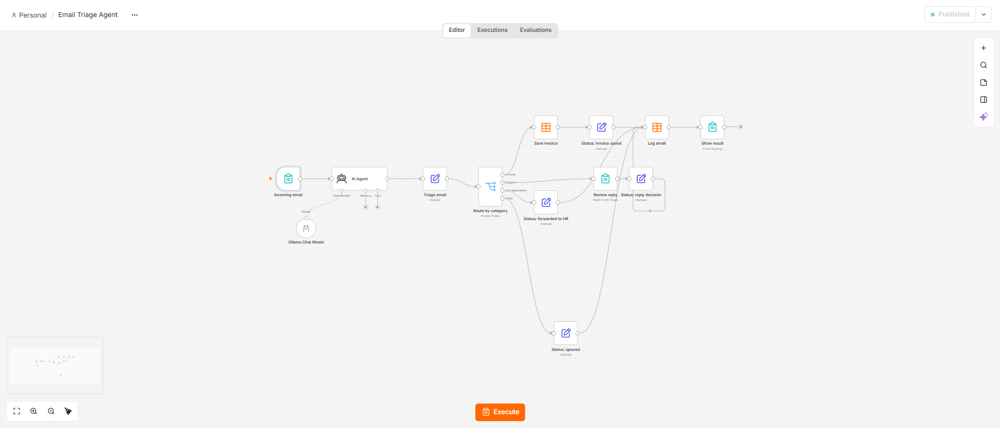
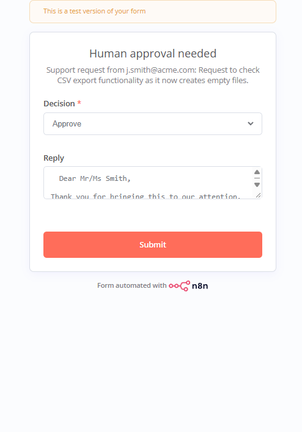
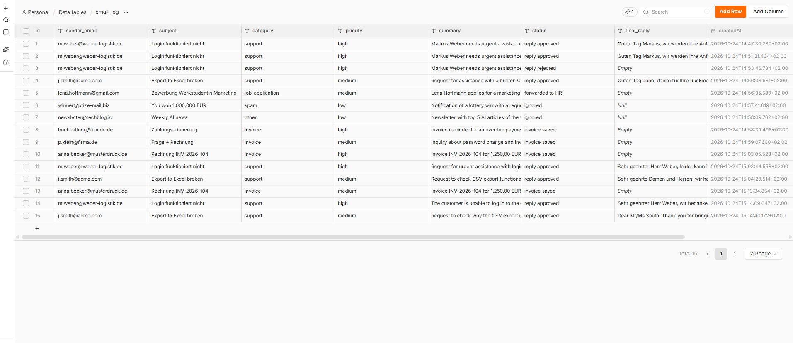
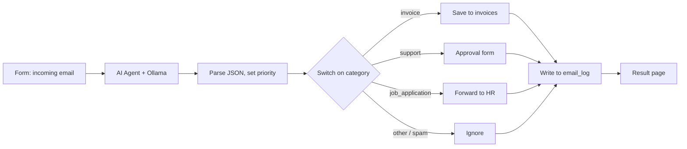

# Email Triage Agent

An n8n workflow that sorts incoming emails with a local LLM. It reads an email, decides what kind of email it is, pulls out the useful data and sends it down the right path. For support emails it writes a draft reply, but nothing is sent until a person has checked it.

I built this to learn n8n and to see how far a small model running on my own laptop (qwen2.5:7b via Ollama) can get on a realistic business task. Everything runs locally, so no email text goes to an external API.



## What happens to an email

- **Invoice:** company, invoice number, amount, currency and due date are saved to an `invoices` table.
- **Support request:** the model drafts a reply in the language of the email. A form shows me the draft, and I can approve it, edit it or reject it.
- **Job application:** logged and marked "forwarded to HR".
- **Spam / anything else:** logged, nothing else happens.

Every email ends up in an `email_log` table with its category, priority, a one-line summary and what happened to it.

Approval page for a support email:



The log after my test runs:



## How it's built



- n8n 2.x, self-hosted in Docker
- Ollama with qwen2.5:7b
- n8n data tables for storage, n8n forms as a stand-in for a real inbox

For now, emails come in through a form instead of Gmail. That let me focus on the AI part first; connecting a real mailbox is the next step.

## Testing

I wrote 8 test emails in German and English: two invoices, two support requests, a job application, a spam mail, a newsletter, and one email that contains both an invoice and a password question.

The categories were right from the start. The problems were in the details, and fixing them took three rounds.

| | First run | After changes |
|---|---|---|
| Category | 8/8 | 8/8 |
| Priority | 7/8 | 8/8 |
| Usable support reply | 0/2 | 2/2 |

### What I changed to make it better

| Problem I saw | Why it happened | What I changed |
|---|---|---|
| An invoice due in three weeks was marked high priority | The model doesn't know today's date, so it can't judge "due within 7 days" | Invoice priority is now calculated in the workflow from the due date (7 days or less = high). The model no longer decides this. |
| The reply was signed "Das Team von Weber Logistik", the customer's own company | The prompt never said who is writing the reply | Added our company name and a fixed signature to the prompt |
| "Guten Tag Markus" is too casual for a German business email | No rules for tone | Added formal greetings: "Sehr geehrter Herr …", or "Sehr geehrte Damen und Herren" if there's no name |
| An English email got a German reply | "Answer in the same language" wasn't enough; the German company context pulled it towards German | The model has to output a `language` field first and then write the reply in that language |
| It made up the first name "John" from j.smith@acme.com | Guessing | Told it to use names only if they're written in the email |
| One reply started with "leider kann ich Ihre Anfrage nicht bearbeiten" (sorry, I can't process your request) | No guidance on what a good reply should do | Reply rule: acknowledge the problem, say we're looking into it, ask for missing details, never refuse |
| n8n's Structured Output Parser kept failing | With qwen2.5 it either wrote the tool call as plain text or returned nothing | Removed the parser, set Ollama to JSON output and parse the result myself in an Edit Fields node |

The biggest takeaway for me: let the model handle language, and do anything that can be calculated (dates, routing, parsing) in normal code.

Still not perfect: one reply thanked the customer for their "Anruf" (call) when it was an email, and another addressed "Mr/Ms Smith". Small things, but they're why the approval step is there. Eight emails is also a small test set, and I'd like to grow it to around 50.

## Running it

You need Docker Desktop and Ollama.

```bash
ollama pull qwen2.5:7b

docker volume create n8n_data
docker run -d --name n8n --restart unless-stopped -p 5678:5678 \
  -e GENERIC_TIMEZONE=Europe/Berlin -e TZ=Europe/Berlin \
  -v n8n_data:/home/node/.n8n docker.n8n.io/n8nio/n8n
```

Then in n8n (http://localhost:5678):

1. Add an Ollama credential with the base URL `http://host.docker.internal:11434`.
2. Create two data tables (Overview → Data tables → Create → From scratch):
   - `email_log`: sender_email, subject, category, priority, summary, status, final_reply (all text)
   - `invoices`: sender_email, company, invoice_number, amount (number), currency, due_date
3. Import `workflow/email-triage-agent.json` and pick your Ollama credential in the Ollama Chat Model node. If the data table nodes show an error, reselect the tables in them.
4. Publish the workflow and open the form's production URL.

## Files

```
workflow/email-triage-agent.json   the workflow
images/                            screenshots
```

## Ideas for later

- Gmail trigger instead of the form
- Send the approved reply automatically
- Try Azure OpenAI and compare it with the local model
- A bigger test set with automatic scoring

Harishwar Reddy · [GitHub](https://github.com/harishwarreddy-01)
